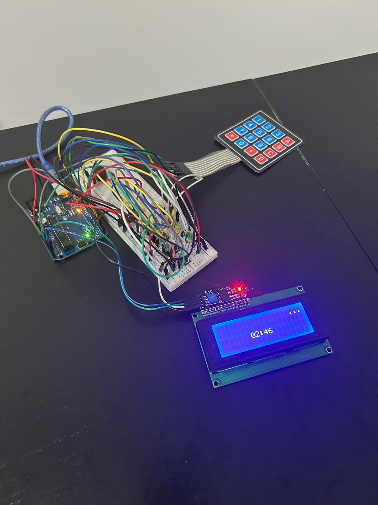

# Super Bomba 3000

## 1. Contexto do projeto

O Super Bomba 3000 é um jogo de Escape Room. O objetivo do jogo é concluir fases e desafios antes que o tempo acabe e evitar que a bomba exploda.

As fases são sorteadas e aparecem em ordem aleatória. Para vencer, é preciso completar todas as fases da dificuldade escolhida, garantindo que não perca suas 3 vidas.

## 2. Tecnologias utilizadas

- Placa: Arduino Uno;
- Linguagem: C/C++ para Arduino;
- Teclado matricial 4x4;
- LEDs e Botões;
- Display, buzzer e fio de detecção;
- Monitor Serial, com comunicação em 9600 baud;
- Arduino IDE ou Arduino CLI;

### Ligações

| Componente        | Conexão no componente | Pino do Arduino |
| :--- | :--- | :--- |
| Teclado matricial | Linha 1               | D12             |
| Teclado matricial | Linha 2               | D10             |
| Teclado matricial | Linha 3               | D9              |
| Teclado matricial | Linha 4               | D8              |
| Teclado matricial | Coluna 1              | D13             |
| Teclado matricial | Coluna 2              | D7              |
| Teclado matricial | Coluna 3              | A3              |
| Teclado matricial | Coluna 4              | A2              |
| LEDs              | LED 1                 | D6              |
| LEDs              | LED 2                 | D5              |
| LEDs              | LED 3                 | D4              |
| LEDs              | LED 4                 | D3              |
| Botões            | ADC1 (quatro botões)  | A1              |
| Buzzer            | Sinal                 | D11             |
| Display LCD I²C   | SDA                   | A4              |
| Display LCD I²C   | SCL                   | A5              |
| Fio de segurança  | Uma extremidade       | D2              |
| Fio de segurança  | Outra extremidade     | GND             |

O firmware usa um display LCD I²C de 20 colunas por 4 linhas no endereço `0x27`. Os quatro botões compartilham a entrada A1 por meio de um circuito resistivo; os valores dos resistores e as demais ligações de alimentação não estão especificados no código. Os LEDs também precisam de resistores limitadores de corrente.

## 3. Como jogar

Conecte um fio entre o pino digital **D2** e o **GND** do Arduino. Em seguida, escolha uma dificuldade no teclado:

| Tecla | Dificuldade | Fases | Tempo |
| --- | --- | --- | --- |
| `1` | Fácil | 3 | 180 segundos |
| `2` | Normal | 4 | 240 segundos |
| `3` | Difícil | 5 | 300 segundos |

A ordem das fases é sorteada a cada partida. As fases começam automaticamente; antes das fases de Memória e Reflexo, há uma contagem regressiva de 5 segundos para preparar as mãos.

O fio precisa estar conectado para iniciar a partida. Se ele for desconectado durante o jogo, a bomba explode e a partida termina.

As fases são sorteadas entre estes desafios:

| Fase | Objetivo |
| --- | --- |
| Labirinto | Chegar à saída sem bater nas paredes. |
| Matemática | Resolver 5 operações. |
| Memória | Repetir sequências de LEDs por 7 rodadas. |
| Capitais | Responder 5 perguntas sobre capitais. |
| Reflexo | Acertar 7 vezes o botão correspondente ao LED aceso. |

### Labirinto

Use o teclado numérico para levar o jogador (`@`) até a saída (`F`), sem atravessar as paredes:

- `2` -> cima
- `8` -> baixo
- `4` -> esquerda
- `6` -> direita

### Matemática

Resolva 5 operações matemáticas. Digite a resposta no teclado e pressione `#` para confirmar.

- `*` apaga o último número digitado
- `#` confirma a resposta

### Memória

Observe a sequência de LEDs e repita-a pressionando os botões correspondentes. A sequência aumenta a cada rodada, até completar 7 rodadas. Há 3 segundos para pressionar cada botão.

### Capitais

Responda 5 perguntas sobre capitais de países. Digite a alternativa correta usando `A`, `B`, `C` ou `D`.

### Reflexo

Quando um LED acender, pressione o botão correspondente em até 2 segundos. É necessário acertar 7 vezes para concluir a fase.

### Vidas e tempo

Cada erro faz o jogador perder uma vida e 10 segundos. Se as 3 vidas acabarem ou o tempo chegar a zero, a bomba explode e a partida termina.

O buzzer, conectado ao pino digital **D11**, emite avisos sonoros nos últimos 10 segundos e toca um alarme quando o jogador perde. O display mostra o tempo e as vidas restantes.

Ao concluir todas as fases da dificuldade escolhida, o jogador vence. Depois do fim da partida, pressione uma tecla para voltar ao menu.

### Reset e interrupções

Para encerrar a partida e voltar ao menu, envie `r` (ou `R`) pelo Monitor Serial. O comando desliga o buzzer e o display e reinicia o estado principal da partida.

O fio de segurança usa a interrupção externa **INT0**, no pino D2. Quando o fio é desconectado durante a partida, a interrupção registra o evento e o jogo termina com a explosão da bomba. O **Timer1** também usa uma interrupção periódica para acompanhar o tempo do jogo.

## 4. Como compilar e executar

### Requisitos

- Arduino IDE instalada no computador.
- Arduino Uno ou placa compatível com o ATmega328P.
- Cabo USB que permita transmissão de dados.
- Componentes do jogo montados e conectados à placa.

### Passo a passo

1. Abra a Arduino IDE e, nela, abra o arquivo `firmware/firmware.ino`.
2. Em **Ferramentas → Placa**, selecione o modelo da sua placa.
3. Clique em **Verificar** para compilar o projeto.
4. Conecte o Arduino ao computador pelo cabo USB.
5. Em **Ferramentas → Porta**, selecione a porta correspondente à placa.
6. Clique em **Carregar** para enviar o programa ao Arduino.
7. Abra o **Monitor Serial** e configure a velocidade para **9600 baud** para acompanhar o menu e as mensagens do jogo.

Após o envio, o programa ficará gravado na placa e será executado quando ela for ligada ou reiniciada.
